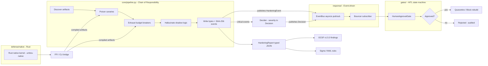

# Umbra Sentry

> **Defense is not obfuscation. It is semantic deception, deterministic chaining, and decoupled response.**
>
> Umbra Sentry hardens your own release artifacts against AI reverse-engineering agents: a poisoned analyst burns tokens on canaries, drowns in budget breakers, and reconstructs shadow decoys — while every action it takes is typed, gated, and exportable to OCSF and Sigma.

**English** · [简体中文](README_zh.md)

**Version:** 1.0.0 | **Strategies:** 5 | **Adapters:** 2 | **Tests:** 164 collected (156 passed, 8 skipped without the Rust kernel)

---

## Security & Open Source Statement

> **Disclaimer**: Umbra Sentry is a **defensive** tool for protecting **your own** software artifacts. It is not a peer-reviewed security project. Some boilerplate and utility code was developed with the assistance of Claude (Anthropic) and reviewed and modified by the author. The author assumes no responsibility for third-party code issues, but commits to promptly addressing valid claims.
>
> This tool **will not make your software secure**. It changes the *economics* of automated reverse-engineering: an AI analyst that opens a hardened artifact pays a token and attention tax, follows fabricated evidence, and reports algorithms that do not exist. A skilled human reverse engineer eventually untangles every layer below — that is a stated limitation, not a hidden one.

Traditional obfuscation answers one question: can the code be read? Umbra Sentry answers a different one: **what will an automated analyst believe?** Defense therefore happens at three semantic layers, never as scattered scripts:

1. **Poison** — plant format-valid canaries and decoy evidence that look like real findings.
2. **Exhaust** — push static analyzers past their documented resource budgets with inert, opaque-guarded filler.
3. **Hallucinate** — leave shadow business logic that a pattern-matching analyst reconstructs as *the* algorithm, while real behavior never changes.

Every step emits strongly-typed events; every consequential remediation passes a human-in-the-loop state machine; every artifact identity is a SHA-256 you can attest.

---

## Why Umbra Sentry?

Existing counter-analysis tools scatter hundreds of scripts across formats with no composition contract, no typed telemetry, and no remediation governance. Umbra Sentry is built to surpass that model on four axes:

| Capability | How |
| --- | --- |
| **Chain-of-responsibility defense pipeline** | Strategies are composable units sorted into a deterministic phase order (audit → poison → exhaust → hallucinate → verify). Later strategies see earlier output; a failing strategy downgrades to FAILED and the chain keeps running. Same seed + same input gives byte-identical output, so hardening is attestable. |
| **Event-driven response (EDA)** | Pipeline, decider, and bouncer never call each other. The pipeline publishes typed HardeningEvent objects; the decider turns critical events into Decision objects and publishes them on the same bus; the bouncer consumes decisions (bus subscription, or a one-shot host hand-off) and executes only what the gate approved. Overflowing slow consumers are shed into an observable dead-letter list, not silently dropped. |
| **Human-in-the-loop state machine** | High-severity remediations do not fire on a heuristic. PENDING → APPROVED → EXECUTED, with DENIED / TIMED_OUT terminals, a full audit trail, and deny-by-default on timeout or channel failure. Approve via CLI flag or webhook. |
| **Typed OCSF / Sigma ecosystem** | An internal IR (HardeningEvent, Decision, HardeningReport) projects bidirectionally into OCSF v1.5.0 Detection Findings (Pydantic-validated, class_uid 2004, type_uid = class_uid × 100 + activity_id) and canonical Sigma YAML rules (deterministic UUID5 ids, round-trip parseable). Your SIEM ingests umbra-sentry output natively. |

---

## Installation and download

Install it as one plugin: the `harden` skill and the CLI run the same pipeline, so splitting the tree breaks both. Every route needs the Python package; the native kernel is an optional Rust build.

### Method 1: install from the plugin marketplace by URL

Register this repository's Git URL as a plugin marketplace on a host that supports plugins, then install the plugin it lists (registering the URL twice is harmless — the second call reports it is already known).

```text
https://github.com/JiamingShi-JsPhys/umbra-sentry
```

### Method 2: install with commands

**Claude Code** — from your shell, marketplace and install in one step:

```bash
claude plugin install umbra-sentry --marketplace https://github.com/JiamingShi-JsPhys/umbra-sentry.git
```

The full command set — the in-session marketplace route, the release-tag pin, the manual clone path and the optional native-kernel build — lives on one page: **[docs/INSTALL_COMMANDS.md](docs/INSTALL_COMMANDS.md)**.

### Method 3: let your AI install it

```bash
Please visit the GitHub repository `https://github.com/JiamingShi-JsPhys/umbra-sentry` and clone it, then run `python -m pip install -e .` from the repository root. If your host has a plugin system, install it as a plugin as well; the plugin provides the `harden` skill and the package provides the CLI.
```

> **Warning**: cloning the repository and stopping there installs nothing. The `harden` skill and the `umbra-harden` command both need the Python package (`pip install -e .`); the native kernel is an optional Rust build.

---

## Quick start

All commands run from the repository root — never hard-code absolute paths.

Only supported formats are touched: the semantic strategies handle `.py`, `.js`, `.ts` and `.json` (canaries also `.toml`, `.cfg`, `.ini`, `.md`), and the native strategies handle compiled/object suffixes (`.exe`, `.dll`, `.so`, `.dylib`, `.bin`, `.elf`, `.o`, `.a`, `.lib`, `.node`). Any other file passes through untouched and produces no events.

### CLI: one command, full pipeline

```bash
# Harden a directory (auto-discovers artifacts, applies all strategies)
python cli.py dist/ --out umbra-report.json

# Export SIEM-native telemetry alongside the report
python cli.py dist/ --sigma sigma-rules/ --ocsf ocsf-findings/ --out umbra-report.json

# Deterministic, attestable hardening (same seed gives identical bytes)
python cli.py dist/ --seed 42 --intensity bankrupt --out umbra-report.json
```

Installed as a script:

```bash
umbra-harden dist/ --intensity maximum
```

Critical findings raise `QUARANTINE` decisions that never execute unattended. Only the decision ids named on the command line are approved; everything else is denied:

```bash
umbra-harden dist/ --quarantine quarantine/ --approve <decision-id>
```

### Programmatic: compose your own chain

```python
from core.pipeline import HardeningPipeline
from defense.poison import CanaryPoisonStrategy
from defense.exhaust import BudgetExhaustStrategy
from defense.hallucinate import ShadowLogicStrategy
from response.event_bus import EventBus

pipe = HardeningPipeline(
    [CanaryPoisonStrategy(), BudgetExhaustStrategy(), ShadowLogicStrategy()],
    bus=EventBus(),
    seed=42,
    intensity="balanced",
)
report = pipe.run("dist/")
print(report.modified_artifacts, len(report.applied_events))
```

### Human-in-the-loop approval

```python
from gates.human_approval import HumanApprovalGate
from response.bouncer import Bouncer

async def webhook_approver(request):
    # Block until your approval UI or webhook answers
    return await poll_approval_service(request.decision_id)

gate = HumanApprovalGate(webhook_approver, timeout_seconds=300)
bouncer = Bouncer(gate)
# ... decisions flow through the bus; bouncer executes only APPROVED ones
```

Denied and timed-out requests never execute; both are recorded with who resolved them and when.

---

## Requirements

- **Python 3.12+**.
- **Pydantic 2.7+** and **PyYAML 6.0+** — declared in `pyproject.toml`; `pip install -e .` installs them.
- **Rust stable** (edition 2021) — optional, and only to build the native kernel in `defense/native/umbra-native`. Without it both native strategies emit an audited `SKIPPED` event and leave compiled artifacts untouched, so a missing toolchain never breaks the pipeline. On Windows, the MSVC target also requires the Visual Studio C++ build tools (`link.exe`); `cargo check --release` can type-check without them, but `cargo build --release` cannot link.

No third-party code is vendored; every dependency stays under its own permissive licence.

---

## Architecture Overview



The pipeline is synchronous and deterministic; the response layer is asynchronous and decoupled. They meet only at the bus.

---

## Polyglot architecture

Orchestration in Python for extensibility; hardening in Rust for raw performance.

Compiled artifacts (PE, ELF, Mach-O and object/library suffixes) leave the Python text path and cross a narrow C ABI into `defense/native/umbra-native`, a zero-dependency Rust kernel built as both a `cdylib` and a standalone CLI. `defense/native_bridge.py` prefers `ctypes` FFI and falls back to a subprocess CLI; when neither artifact has been built, both native strategies emit an audited `SKIPPED` event and leave the file untouched, so a missing toolchain never breaks the pipeline. Both transports drive the same append-only, seed-deterministic engine, so a hardened binary still loads and the same `(seed, input)` always yields identical bytes.

Build the kernel once:

```bash
cd defense/native/umbra-native && cargo build --release
```

| Phase | Python strategy | Native strategy | Kernel entry point |
| --- | --- | --- | --- |
| POISON | `poison-canary` | `native-poison` | `umbra_poison_binary` |
| EXHAUST | `exhaust-budget` | `native-exhaust` | `umbra_exhaust_binary` |
| HALLUCINATE | `hallucinate-shadow` | — | Python only |

---

## Repository layout

```text
umbra-sentry/
├── .claude-plugin/
│   ├── marketplace.json   # self-hosted marketplace entry (plugin install by URL)
│   └── plugin.json        # Claude Code plugin manifest (ships the harden skill)
├── adapters/
│   ├── ocsf_adapter.py    # IR <-> OCSF v1.5.0 Detection Findings (Pydantic)
│   └── sigma_adapter.py   # IR <-> Sigma YAML rules (deterministic UUID5)
├── core/
│   ├── models.py          # typed IR: HardeningEvent, Decision, HardeningReport
│   └── pipeline.py        # defense chain of responsibility (phase-ordered)
├── defense/
│   ├── base.py            # BaseDefenseStrategy contract
│   ├── poison.py          # canary + decoy-evidence injection
│   ├── exhaust.py         # resource-budget breakers
│   ├── hallucinate.py     # shadow business logic
│   ├── markers.py         # trailer markers shared by the strategies
│   ├── native_bridge.py   # ctypes FFI + subprocess CLI fallback
│   ├── native_strategies.py
│   └── native/umbra-native/  # zero-dependency Rust kernel (cdylib + CLI)
├── docs/
│   ├── INSTALL_COMMANDS.md
│   ├── INSTALL_COMMANDS_zh.md
│   ├── ACKNOWLEDGEMENTS.md
│   └── ACKNOWLEDGEMENTS_zh.md
├── gates/
│   └── human_approval.py  # HITL state machine (fail-closed)
├── response/
│   ├── event_bus.py       # typed asyncio pub/sub with backpressure
│   └── bouncer.py         # Decision subscriber + gated executor
├── skills/
│   └── harden/SKILL.md    # agent-invocable harden skill
├── tests/                 # pytest suite (164 collected; 156 pass without the Rust kernel)
├── cli.py                 # umbra-harden entry point
├── pyproject.toml
├── CHANGELOG.md
├── README.md · README_zh.md
└── LICENSE                # Apache-2.0
```

---

## Tests

```bash
python -m pytest -q      # 164 collected: 156 passed, 8 skipped without the Rust kernel
python -m ruff check .   # All checks passed
```

The suite covers pipeline phase ordering and seed determinism, failure isolation between strategies, all five defense strategies, the event bus (including overflow and dead-letter behaviour), the HITL gate's approve / deny / timeout / replay paths, the bouncer's gated execution, OCSF and Sigma round-trips, the native bridge's FFI and CLI transports (including determinism and spoofed-marker resistance), and the regressions fixed during review.

The native kernel ships no Rust tests of its own; build it to check that the FFI and CLI transports compile:

```bash
cd defense/native/umbra-native && cargo build --release
```

On Windows, `cargo build --release` needs the Visual Studio C++ build tools; without them, the eight native tests stay skipped and `cargo check --release` is the available type-check.

---

## Known limitations

Honesty is part of the threat model:

- **Human reverse engineers are out of scope.** Every technique here raises the cost for *automated* analysis. A patient human analyst with a debugger untangles canaries, recognizes inert filler, and identifies shadow logic as unreachable. We do not claim protection against skilled manual RE.
- **Canaries are synthetic.** All planted credentials, keys, and ids are deterministic fabrications from a fixed vocabulary. They look real; they are not, and a fingerprinting analyst may detect the vocabulary.
- **Exhaust layers are bounded.** Filler density scales with intensity but is capped so the artifact stays shippable; a determined analyzer that strips dead branches pays a one-time cost, not a recurring tax.
- **Runtime equivalence is the goal, not a proof.** Shadow logic is appended after real code and never called, and exhaust blocks are opaque-false-guarded, but no formal equivalence verification is performed — test your build after hardening.
- **Sigma rules audit your own hardening.** Rules emitted here detect umbra-sentry activity in your logs, not arbitrary third-party threats.
- **One OCSF class, not the full surface.** The projection covers Detection Findings (class_uid 2004); other OCSF classes are out of scope.
- **The native kernel is optional.** Without a Rust build, compiled artifacts pass through untouched and the run records `SKIPPED` events — the report tells you, but the binary is not hardened.

---

## Report issues

**Regular bugs / feature requests**: file them on the repository's [Issues](https://github.com/JiamingShi-JsPhys/umbra-sentry/issues) page. Include reproduction steps, expected behavior, actual behavior, and the environment (operating system, Python version, Rust version if the native kernel is involved).

**Security vulnerabilities (this category only)**: do **not** use the public Issues page. Email `jiamingshi_git@outlook.com` instead.

- **Subject**: must carry the prefix `report_` plus the specific product or component and a short summary.
  - Example: `report_umbra-sentry: hardened binary fails to load after the poison stage`
- **Body**: must include detailed reproduction steps and the environment.
- For serious "file loss or corruption" reports, attach the before/after directory trees (`tree` output) and the generated `umbra-report.json`.

*Contributors who file clear, reproducible issues or pull requests will be credited in the next release's notes and in [Acknowledgements](#acknowledgements).*

---

## Trademarks

"Claude" and "Claude Code" are trademarks of Anthropic, PBC. Umbra Sentry is not affiliated with, endorsed by, or sponsored by Anthropic. Names referenced as design inspiration (bla, py-ocsf-models, sigma-cli / pySigma, CrowdSec) belong to their respective owners.

---

## Acknowledgements

No external issue reporters or code contributors yet. Architecture and research inspiration: bla, py-ocsf-models, sigma-cli / pySigma, CrowdSec.

[Full acknowledgements](docs/ACKNOWLEDGEMENTS.md)

## License

[Apache-2.0](LICENSE) (c) 2026 JiamingShi-JsPhys

**Author & Maintainer**: Jiaming Shi (Westlake University) · [JiamingShi-JsPhys](https://github.com/JiamingShi-JsPhys)
