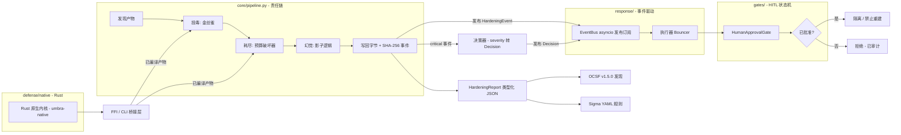

# Umbra Sentry

> **防御不只是混淆，而是语义层的欺骗、确定性的责任链与解耦的响应。**
>
> Umbra Sentry 加固你自己的发布产物，对抗 AI 逆向工程代理：被投毒的分析师在金丝雀上烧 token，在预算破坏器中溺亡，并"重建"出影子诱饵算法——而它的每一个动作都是强类型、有人工门控、可导出为 OCSF 和 Sigma 的。

[English](README.md) · **简体中文**

**版本:** 1.0.0 | **防御策略:** 5 | **适配器:** 2 | **测试:** 164 个用例（未构建 Rust 内核时 156 passed, 8 skipped）

---

## 安全与开源声明

> **免责声明**：Umbra Sentry 是一个**防御性**工具，用于保护**你自己的**软件产物。它不是经同行评审的安全项目。部分样板代码与工具代码在 Claude（Anthropic）协助下开发，并由作者审查与修改。作者不对第三方代码问题承担责任，但承诺及时处理有效索赔。
>
> 这个工具**不会让你的软件变得安全**。它改变的是自动化逆向工程的*经济学*：打开加固产物的 AI 分析师要付出 token 与注意力的税，追查伪造的证据，并报告不存在的算法。而有经验的人工逆向工程师最终能拆解下述所有层次——这是明说的局限，不是隐藏的缺陷。

传统混淆回答的是"代码能不能被读懂？"。Umbra Sentry 回答的是另一个问题：**自动化分析师会相信什么？** 因此防御发生在三个语义层，而不是散落的脚本：

1. **投毒（Poison）**——植入格式合法的金丝雀与诱饵证据，看起来像真实发现。
2. **耗尽（Exhaust）**——用惰性的、不透明谓词保护的填充物，把静态分析器推过其文档化的资源预算。
3. **幻觉（Hallucinate）**——留下影子"业务逻辑"，让模式匹配的分析师把它重建为*那一个*算法，而真实行为从未改变。

每一步都发出强类型事件；每一个后果性处置动作都经过人工介入状态机；每一个产物身份都是可认证的 SHA-256。

---

## 为什么选择 Umbra Sentry？

现有的对抗分析工具把数百个脚本散落在各种格式上：没有组合契约、没有类型化遥测、没有处置治理。Umbra Sentry 在四个维度上全面超越：

| 能力 | 实现 |
| --- | --- |
| **责任链防御流水线** | 策略是可组合的单元，按确定的阶段顺序执行（audit → poison → exhaust → hallucinate → verify）。后面的策略看到前面策略的输出；失败策略降级为 FAILED，责任链继续运行。相同 seed + 相同输入 ⇒ 逐字节相同的输出，加固可认证。 |
| **事件驱动响应（EDA）** | 流水线、决策器、执行器（bouncer）之间零直接调用。流水线发布强类型 HardeningEvent；决策器把 critical 事件转成 Decision 并发布到同一条总线；执行器消费决策（总线订阅，或由一次性宿主直接交付），只执行门控批准的动作。慢消费者溢出进入可观测的死信列表，而不是被静默丢弃。 |
| **人工介入状态机（HITL）** | 高危处置不会因启发式直接触发。PENDING → APPROVED → EXECUTED，带 DENIED / TIMED_OUT 终态、完整审计轨迹，以及超时/通道故障时默认拒绝。可通过 CLI 参数或 Webhook 批准。 |
| **纯正 OCSF / Sigma 生态** | 内部 IR（HardeningEvent、Decision、HardeningReport）双向投影为 OCSF v1.5.0 Detection Findings（Pydantic 强校验，class_uid 2004，type_uid = class_uid × 100 + activity_id）与规范 Sigma YAML 规则（确定性 UUID5 id，可往返解析）。你的 SIEM 原生摄入 umbra-sentry 的输出。 |

---

## 安装与下载

请按一个完整插件安装：`harden` 技能与 CLI 运行同一条流水线，拆散目录会让两者都失效。无论哪种路线都需要 Python 包；原生内核是可选的 Rust 构建。

### 方式一：按 URL 从插件市场安装

在支持插件的宿主上，把本仓库的 Git URL 注册为插件市场，然后安装它列出的插件（重复注册 URL 无害——第二次会提示已知晓）。

```text
https://github.com/JiamingShi-JsPhys/umbra-sentry
```

### 方式二：用命令安装

**Claude Code** —— 在终端执行，一步完成市场注册与安装：

```bash
claude plugin install umbra-sentry --marketplace https://github.com/JiamingShi-JsPhys/umbra-sentry.git
```

完整命令——会话内市场注册、发布 tag 锁定、手动克隆路径与可选原生内核构建——都在这一页：**[docs/INSTALL_COMMANDS_zh.md](docs/INSTALL_COMMANDS_zh.md)**。

### 方式三：让 AI 帮你安装

```bash
请访问 GitHub 仓库 `https://github.com/JiamingShi-JsPhys/umbra-sentry` 并克隆它，然后在仓库根目录运行 `python -m pip install -e .`。如果你的宿主有插件系统，也把它作为插件安装；插件提供 `harden` 技能，Python 包提供 CLI。
```

> **警告**：只克隆仓库而不安装等于什么都没装。`harden` 技能与 `umbra-harden` 命令都依赖 Python 包（`pip install -e .`）；原生内核是可选的 Rust 构建。

---

## 快速开始

所有命令都在仓库根目录运行——**不要硬编码绝对路径**。

只处理受支持的格式：语义策略处理 `.py`、`.js`、`.ts`、`.json`（金丝雀还支持 `.toml`、`.cfg`、`.ini`、`.md`），原生策略处理编译/目标文件后缀（`.exe`、`.dll`、`.so`、`.dylib`、`.bin`、`.elf`、`.o`、`.a`、`.lib`、`.node`）。其他文件原样通过，不产生任何事件。

### CLI：一条命令，完整流水线

```bash
# 加固一个目录（自动发现产物，应用全部策略）
python cli.py dist/ --out umbra-report.json

# 随报告导出 SIEM 原生遥测
python cli.py dist/ --sigma sigma-rules/ --ocsf ocsf-findings/ --out umbra-report.json

# 确定性、可认证的加固（相同 seed 得到相同字节）
python cli.py dist/ --seed 42 --intensity bankrupt --out umbra-report.json
```

安装为脚本后：

```bash
umbra-harden dist/ --intensity maximum
```

高危发现会触发 `QUARANTINE` 决策，绝不在无人值守时执行。只有命令行点名的决策 id 会被批准，其余一律拒绝：

```bash
umbra-harden dist/ --quarantine quarantine/ --approve <decision-id>
```

### 编程接口：组装你自己的责任链

```python
from core.pipeline import HardeningPipeline
from defense.poison import CanaryPoisonStrategy
from defense.exhaust import BudgetExhaustStrategy
from defense.hallucinate import ShadowLogicStrategy
from response.event_bus import EventBus

pipe = HardeningPipeline(
    [CanaryPoisonStrategy(), BudgetExhaustStrategy(), ShadowLogicStrategy()],
    bus=EventBus(),
    seed=42,
    intensity="balanced",
)
report = pipe.run("dist/")
print(report.modified_artifacts, len(report.applied_events))
```

### 人工介入批准

```python
from gates.human_approval import HumanApprovalGate
from response.bouncer import Bouncer

async def webhook_approver(request):
    # 阻塞直到你的审批 UI 或 Webhook 应答
    return await poll_approval_service(request.decision_id)

gate = HumanApprovalGate(webhook_approver, timeout_seconds=300)
bouncer = Bouncer(gate)
# ... Decision 经过总线流动；执行器只执行 APPROVED 的
```

被拒绝与超时的请求永远不会执行；两者都会记录是谁、在何时做出的裁决。

---

## 环境要求

- **Python 3.12+**。
- **Pydantic 2.7+** 与 **PyYAML 6.0+**——已在 `pyproject.toml` 中声明，`pip install -e .` 会自动安装。
- **Rust stable**（edition 2021）——可选，仅用于构建 `defense/native/umbra-native` 原生内核。不构建时，两个原生策略会发出可审计的 `SKIPPED` 事件并保持编译产物不变，因此缺少工具链绝不会中断流水线。Windows 的 MSVC 目标还需要 Visual Studio C++ 构建工具（`link.exe`）；没有它们时 `cargo check --release` 仍可做类型检查，但 `cargo build --release` 无法链接。

项目不内嵌任何第三方代码；所有依赖均遵循各自宽松许可证。

---

## 架构总览



流水线是同步且确定性的；响应层是异步且解耦的。它们只在事件总线上相遇。

---

## 混合语言架构

核心编排 Python 化以便于扩展，底层加固 Rust 化以追求极致性能。

编译型产物（PE、ELF、Mach-O 以及目标文件/库后缀）不再走 Python 文本路径，而是通过一层窄 C ABI 进入 `defense/native/umbra-native`——一个零外部依赖的 Rust 内核，同时构建为 `cdylib` 与独立 CLI。`defense/native_bridge.py` 优先使用 `ctypes` FFI，失败时回退到 subprocess CLI；若两者都未构建，两个原生策略会发出可审计的 `SKIPPED` 事件并保持文件不变，因此缺少工具链绝不会中断流水线。两条传输通道驱动同一个仅追加、种子确定的引擎，所以加固后的二进制仍可正常加载，且相同的 `(seed, input)` 始终产生逐字节相同的结果。

构建一次即可：

```bash
cd defense/native/umbra-native && cargo build --release
```

| 阶段 | Python 策略 | 原生策略 | 内核入口 |
| --- | --- | --- | --- |
| POISON | `poison-canary` | `native-poison` | `umbra_poison_binary` |
| EXHAUST | `exhaust-budget` | `native-exhaust` | `umbra_exhaust_binary` |
| HALLUCINATE | `hallucinate-shadow` | — | 仅 Python |

---

## 仓库结构

```text
umbra-sentry/
├── .claude-plugin/
│   ├── marketplace.json   # 自托管插件市场条目（按 URL 安装）
│   └── plugin.json        # Claude Code 插件清单（提供 harden 技能）
├── adapters/
│   ├── ocsf_adapter.py    # IR <-> OCSF v1.5.0 Detection Findings（Pydantic）
│   └── sigma_adapter.py   # IR <-> Sigma YAML 规则（确定性 UUID5）
├── core/
│   ├── models.py          # 类型化 IR：HardeningEvent、Decision、HardeningReport
│   └── pipeline.py        # 防御责任链（按阶段排序）
├── defense/
│   ├── base.py            # BaseDefenseStrategy 契约
│   ├── poison.py          # 金丝雀 + 诱饵证据注入
│   ├── exhaust.py         # 资源预算破坏器
│   ├── hallucinate.py     # 影子业务逻辑
│   ├── markers.py         # 各策略共享的尾部标记
│   ├── native_bridge.py   # ctypes FFI + subprocess CLI 回退
│   ├── native_strategies.py
│   └── native/umbra-native/  # 零依赖 Rust 内核（cdylib + CLI）
├── docs/
│   ├── INSTALL_COMMANDS.md
│   ├── INSTALL_COMMANDS_zh.md
│   ├── ACKNOWLEDGEMENTS.md
│   └── ACKNOWLEDGEMENTS_zh.md
├── gates/
│   └── human_approval.py  # HITL 状态机（默认拒绝）
├── response/
│   ├── event_bus.py       # 类型化 asyncio 发布订阅，带背压
│   └── bouncer.py         # Decision 订阅者 + 门控执行器
├── skills/
│   └── harden/SKILL.md    # 代理可调用的 harden 技能
├── tests/                 # pytest 测试套件（收集 164 项；未构建 Rust 内核时 156 passed）
├── cli.py                 # umbra-harden 入口
├── pyproject.toml
├── CHANGELOG.md
├── README.md · README_zh.md
└── LICENSE                # Apache-2.0
```

---

## 测试

```bash
python -m pytest -q      # 共收集 164 个：未构建 Rust 内核时 156 passed, 8 skipped
python -m ruff check .   # All checks passed
```

测试覆盖：流水线阶段顺序与种子确定性、策略间故障隔离、全部五种防御策略、事件总线（含溢出与死信行为）、HITL 门控的批准 / 拒绝 / 超时 / 重放路径、执行器的门控执行、OCSF 与 Sigma 往返转换、原生桥接的 FFI 与 CLI 两条传输（含确定性与伪造标记抵抗），以及评审期间修复的回归项。

原生内核本身不带 Rust 测试；构建一次即可验证 FFI 与 CLI 传输能够编译：

```bash
cd defense/native/umbra-native && cargo build --release
```

Windows 上 `cargo build --release` 需要 Visual Studio C++ 构建工具；没有它们时，8 个原生测试保持 skipped，`cargo check --release` 是可用的类型检查。

---

## 已知局限

诚实是威胁模型的一部分：

- **人工逆向工程师不在防护范围内。** 本工具的所有技术都是抬高*自动化*分析的成本。有耐心的分析师用调试器就能拆解金丝雀、识别惰性填充、把影子逻辑判为不可达代码。我们不声称能防御熟练的人工逆向。
- **金丝雀是合成的。** 所有植入的凭证、密钥与 id 都是从固定词表确定性生成的伪造品。它们看起来是真的；但确实不是，指纹分析者可能识别出这个词表。
- **耗尽层是有界的。** 填充密度随强度缩放但有上限，产物必须保持可发布；能剥离死分支的坚定分析者付出的是一次性成本，不是持续税。
- **运行时等价是目标，不是证明。** 影子逻辑追加在真实代码之后且从不被调用，耗尽块由不透明假谓词保护，但项目不做形式化等价验证——加固后请测试你的构建。
- **Sigma 规则审计的是你自己的加固。** 这里发出的规则检测的是 umbra-sentry 在你日志中的活动，不是任意第三方威胁。
- **一个 OCSF 类，不是全表面。** 投影只覆盖 Detection Findings（class_uid 2004）；其他 OCSF 类不在范围内。
- **原生内核是可选的。** 没有 Rust 构建时，编译产物原样通过，运行记录 `SKIPPED` 事件——报告会告诉你，但二进制没有被加固。

---

## 报告问题

**普通 bug / 功能请求**：请提交到仓库的 [Issues](https://github.com/JiamingShi-JsPhys/umbra-sentry/issues) 页面。请附上复现步骤、期望行为、实际行为与环境（操作系统、Python 版本；涉及原生内核时附 Rust 版本）。

**安全漏洞（仅限此类）**：**不要**使用公开 Issues。请发送邮件至 `jiamingshi_git@outlook.com`。

- **主题**：必须带 `report_` 前缀，加上具体产品或组件名和简短摘要。
  - 示例：`report_umbra-sentry: 加固后的二进制在投毒阶段后无法加载`
- **正文**：必须包含详细复现步骤与环境。
- 严重的"文件丢失或损坏"报告，请附上加固前后的目录树（`tree` 输出）与生成的 `umbra-report.json`。

*提交清晰、可复现 Issue 或 Pull Request 的贡献者，将被列入下个版本 Release 说明与[致谢](#致谢)名单。*

---

## 商标声明

"Claude" 与 "Claude Code" 是 Anthropic, PBC 的商标。Umbra Sentry 与 Anthropic 无隶属、赞助或背书关系。作为设计灵感提及的名称（bla、py-ocsf-models、sigma-cli / pySigma、CrowdSec）归各自所有者所有。

---

## 致谢

目前还没有外部 issue 报告者或代码贡献者。架构与研究启发：bla、py-ocsf-models、sigma-cli / pySigma、CrowdSec。

[详细致谢](docs/ACKNOWLEDGEMENTS_zh.md)

## 开源许可

[Apache-2.0](LICENSE) (c) 2026 JiamingShi-JsPhys

**作者与维护者**：Jiaming Shi（Westlake University）· [JiamingShi-JsPhys](https://github.com/JiamingShi-JsPhys)
